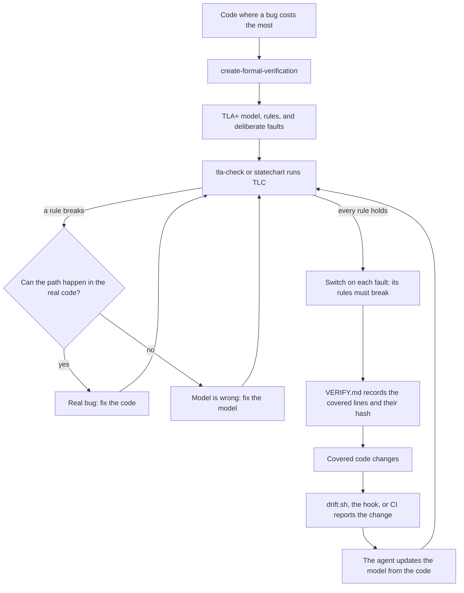

# How it works

1. `create-formal-verification` picks the code where a bug costs the most, and writes a model of it, the rules it must keep, and a switch for each deliberate fault.
2. `tla-check` or `statechart` runs the model through every order of steps.
3. When a rule breaks, the agent replays the path against the real code. If the path can happen, the code has a bug. If it cannot, the model is wrong. Either way the check runs again after the fix.
4. When every rule holds, the agent switches on each fault and confirms that its rules break.
5. `VERIFY.md`, next to the model, records the rules, the faults, and the lines of code that the model depends on, with a hash of them.
6. When those lines change, `drift.sh`, the hook, or CI reports it. The agent updates the model from the code, and the loop starts again at step 2.

A pass counts only if the check can still fail, so each model carries faults that must break named rules, and every step of the model must be seen to run.

The [README](../README.md) describes the record and the three ways the check runs without anyone remembering it. [`examples/counter`](../examples/counter) is a complete worked example.
