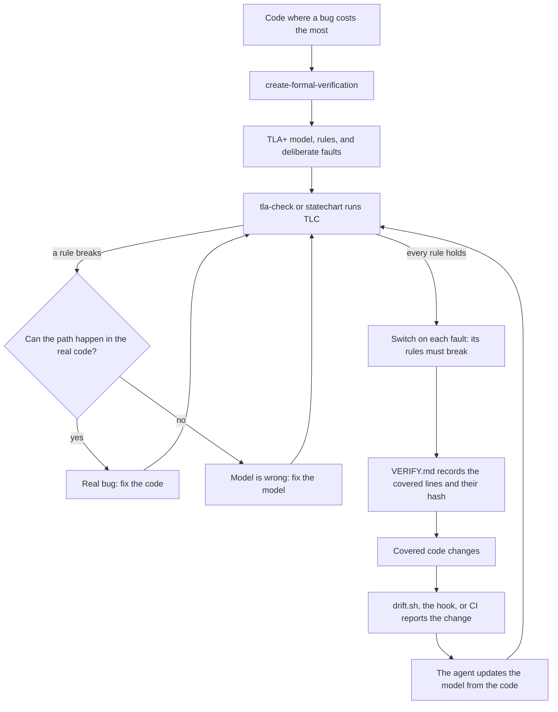

# How it works



1. `create-formal-verification` picks the code where a bug costs the most, and writes a model of it, the rules it must keep, and a switch for each deliberate fault.
2. `tla-check` or `statechart` runs the model through every order of steps.
3. When a rule breaks, the agent replays the path against the real code. If the path can happen, the code has a bug. If it cannot, the model is wrong. Either way the check runs again after the fix.
4. When every rule holds, the agent switches on each fault and confirms that its rules break.
5. `VERIFY.md`, next to the model, records the rules, the faults, and the lines of code that the model depends on, with a hash of them.
6. When those lines change, `drift.sh`, the hook, or CI reports it. The agent updates the model from the code, and the loop starts again at step 2.

A pass counts only if the check can still fail, so each model carries faults that must break named rules, and every step of the model must be seen to run.

## The record

The verification lives in the project as a committed file, `VERIFY.md`, next to the model. It holds the rules, the command, the faults, the limits, and the lines of code that the model depends on:

```
covered:
  - examples/counter/counter.py 49d00fd4737e
    > def hit():
    > with lock:
    > seen = count
    > count = seen + 1
```

Each `> ` line cites a line of the file by its text. The hash covers the text from the first cited line to the last. `drift.sh` stays quiet for an edit outside that stretch, reports an edit inside it, and names a cited line that is missing or moved. `drift.sh --sync` writes the new hash, and the agent runs it only after the model describes the changed code and the check passes.

[`examples/counter`](../examples/counter) is a complete worked example: the code, the model, its config, and the record.

## What keeps it checked

**The hook, in the agent.** The install for Claude Code, Codex, and Pi sets it up. After the agent edits a file, the hook runs `drift.sh`. If the edit changed covered code, the agent gets this reminder, and nothing otherwise:

```
formal-proofs: this edit changed verified code, which no longer matches its record.
examples/counter/VERIFY.md: examples/counter/counter.py: cited line is missing or moved: with lock:.
Before you finish, follow that record: make the verification describe the change and run
the check. Only then run, from the root of the repo: sh .../drift.sh --sync examples/counter/VERIFY.md
```

**The GitHub Action, in CI.** It fails the build when covered code changed without a re-sync of its record, or when a model breaks a rule. The [README](../README.md) shows the step, and this repo's own [CI](../.github/workflows/ci.yml) runs it on the example.

**A trace of a real run.** A hash says that covered lines changed. A trace says whether the code still does what the model describes: a test runs the real code, the code logs each step, and `tla-check` checks that the model can take the same steps. The action runs it with the `traces` input. [`examples/counter-rs`](../examples/counter-rs) does this for Rust code, next to a check that runs the real code under every order of its threads.

**By hand, anywhere.** From the root of your project:

```sh
sh path/to/skills/maintain-formal-verification/drift.sh          # exit 1 when covered code changed
sh path/to/skills/tla-check/check.sh formal/session/Session.tla  # exit 12 when a rule breaks
sh path/to/skills/tla-check/trace.sh formal/session/SessionTrace.tla trace.log  # exit 1 when the code left the model
```

## Versions

The version is in five manifests, one for each way to install, and CI checks that they agree. `tla-check` pins TLC 1.7.4 by checksum and keeps the jar in `~/.cache/tla-check`.
